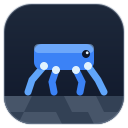
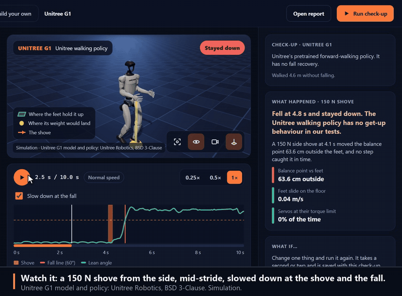
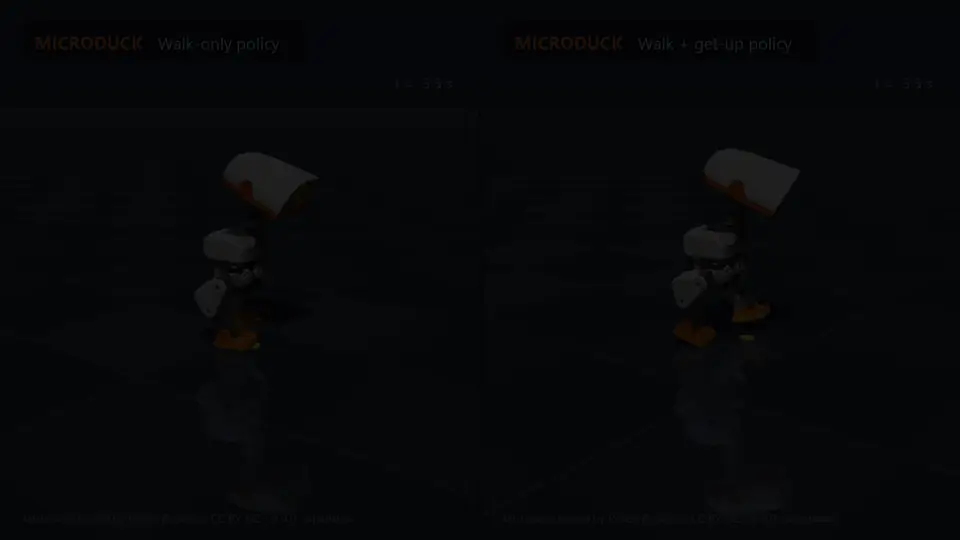

<p align="center">
  
</p>

<h1 align="center">Creature Lab</h1>

<p align="center"><strong>Shove a real robot, see exactly why it fell, and prove the fix.<br />On a laptop, in a browser.</strong></p>

<p align="center">
  <a href="https://github.com/oney-erge/Creature-Lab/actions/workflows/ci.yml"></a>
  <a href="https://pypi.org/project/creature-lab/"></a>
  
  <a href="LICENSE"></a>
</p>

<p align="center">
  <a href="https://oneyerge.com/media/creature-lab-tour.mp4"></a>
</p>

<p align="center"><sub>The real app on saved runs: a 150 N shove, why it fell, and one click to try it gentler.
<a href="https://oneyerge.com/media/creature-lab-tour.mp4">Watch the 1-minute tour</a>. Unitree G1 model and policy by Unitree Robotics, BSD 3-Clause. Simulation.</sub></p>

Creature Lab runs published robots with their **real trained walking policies**. It shoves them at
dozens of strengths and moments, and it tries slippery floors, loads and weak batteries. Then it
explains every fall from the recorded evidence: where the weight went relative to the feet, how
fast the feet slid, and whether the motors ran out of torque. Change one thing, or swap the policy,
and see whether the fall is fixed. The physics runs on the CPU (MuJoCo). It is a simulation, not
the hardware.

## Try it

```bash
uvx --from "creature-lab[app]" creature-lab      # or: pip install "creature-lab[app]", then creature-lab
```

Or from a clone, which also gives you the classic editor and the tests:

```bash
git clone https://github.com/oney-erge/Creature-Lab.git
cd Creature-Lab
./run.sh            # macOS: ./run.command   Windows: run.bat
```

Either way it installs prebuilt packages only (no compiler, about 300 MB) and opens the app. Press
**Download and check up** on the Unitree G1 and accept its license. On a laptop, the download and a
40-shove check-up took 31 s from an empty cache.

## What you can do

- **Watch a shove in 3D**, slowed down at the shove and the fall. The app draws the floor area that
  holds the robot up and the point where its weight would land.
- **Read why it fell** in plain words, with the numbers behind it.
- **Ask "what if"**: shove from the other side, harder or gentler, on a slippery floor, slower,
  faster or carrying a load. It runs again in about a second and plays beside the original.
- **Compare two policies** on the same shove. The Microduck has a walk-only policy and Pollen's newer
  walk-and-get-up policy.
- **Check for regressions** from the command line: `robots compare` says which tests got better or
  worse between two check-ups (`--fail-on-regression` for CI), and `robots card` writes an SVG
  robustness card for a README or model card.
- **Build your own** quadruped, hexapod, worm or humanoid with sliders, and run it.

<p align="center">
  
</p>

<p align="center"><sub>The same shove at the same instant, two policies for one robot (simulation). Microduck model by Pollen Robotics, CC BY-NC-SA 4.0.</sub></p>

## From the command line

```bash
uv sync --inexact --extra robots
uv run creature-lab robots checkup unitree-g1     # or: microduck
uv run creature-lab robots compare BEFORE_DIR AFTER_DIR --fail-on-regression
```

A check-up writes an HTML report; add `--film` for a 1080p film. See
[Robot check-up](docs/ROBOT_CHECKUP.md) for the tests, how falls are explained, licenses and limits.

Creature Lab started as a workbench for designing modular robots, and that is still here: a zoo of
working and deliberately broken creatures, a part-by-part build editor with URDF import and export,
root-cause diagnosis, and search for better bodies and gaits (`creature-lab zoo`, `build`,
`autopsy`, `evolve`). PyBullet is optional for these (`uv sync --inexact --extra sim`); outside
Linux it is built from source and needs a C++ compiler, so the launcher leaves it out and MuJoCo is
used instead.

## What it is not

A teaching and prototyping tool, not hardware qualification, a cloud service or large-scale GPU
training. Check-ups are deterministic simulations of published models; a robot that passes here can
still fall on a real floor.

## Documentation

| Guide | Use it for |
|---|---|
| [Browser app](docs/WEB_APP.md) | Robots, replays, "what if" and check-ups in the app |
| [Robot check-up](docs/ROBOT_CHECKUP.md) | The tests, how falls are explained, licenses |
| [Getting started](docs/GETTING_STARTED.md) | A first experiment, and troubleshooting |
| [CLI reference](docs/CLI_REFERENCE.md) | Every command and export |
| [Known issues](docs/KNOWN_ISSUES.md) | Current limitations |
| [All documentation](docs/README.md) | Build editor, zoo, failure lab, schemas, contributing |

If the launcher fails, it prints what to do; `uv run creature-lab doctor` checks the setup. Docker
serves the same app on localhost: `./run.sh docker`.

Apache-2.0. Built by [Oney Erge](https://oneyerge.com).
