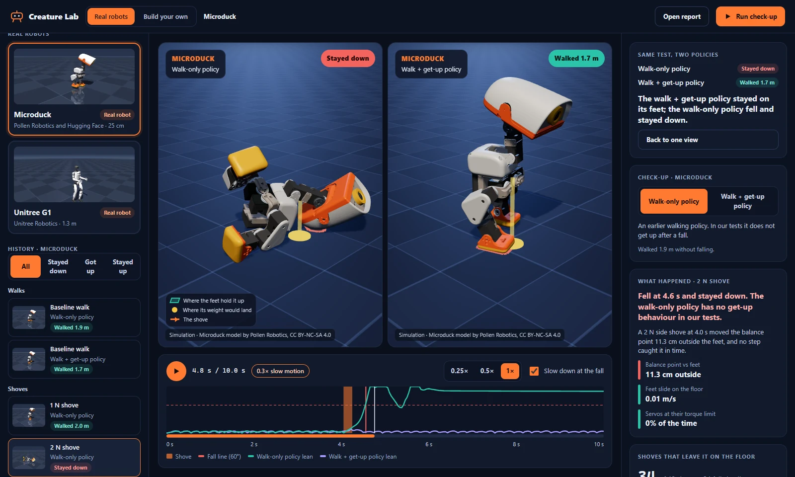
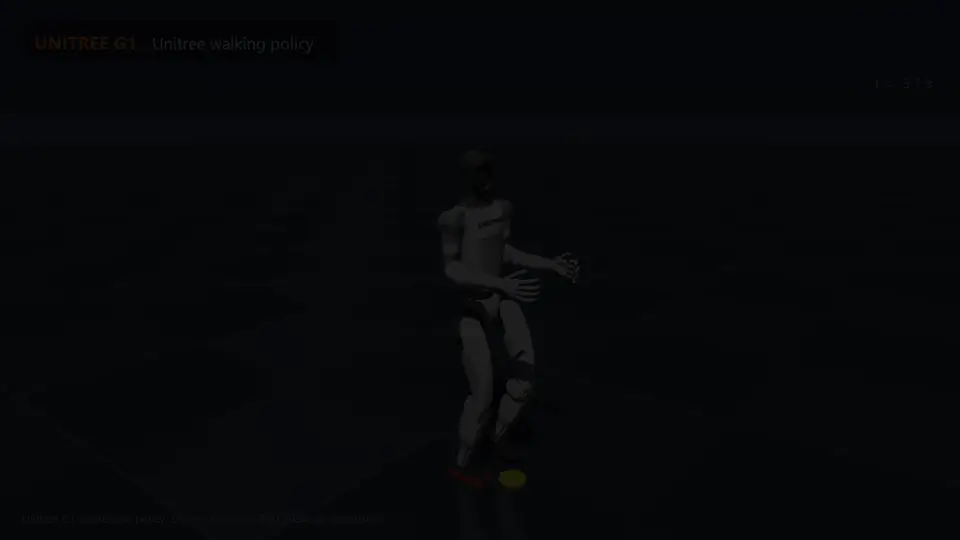

<p align="center">
  
</p>

<h1 align="center">Creature Lab</h1>

<p align="center"><strong>Shove a real robot, see exactly why it fell, and prove the fix.<br />On a laptop, in a browser.</strong></p>

<p align="center">
  <a href="https://github.com/oney-erge/Creature-Lab/actions/workflows/ci.yml"></a>
  
  <a href="LICENSE"></a>
</p>

<p align="center">
  
</p>

<p align="center"><sub>The same shove, the same instant, two policies for the same robot (simulation). Microduck model by Pollen Robotics, CC BY-NC-SA 4.0.</sub></p>

Creature Lab runs published robots with their **real trained walking policies**, shoves them at
dozens of strengths and moments, makes the floor slippery or the battery weak, and explains every
fall from the recorded evidence: where the weight went relative to the feet, how fast the feet
slid, whether the motors ran out of torque. Then it puts a second policy through the same shove, so
you can see whether a change actually fixes the fall. The physics runs on the CPU (MuJoCo). It is a
simulation, not the hardware.

## Try it

```bash
git clone https://github.com/oney-erge/Creature-Lab.git
cd Creature-Lab
./run.sh            # Linux; macOS: ./run.command; Windows: .\run.bat
```

The launcher installs what it needs (prebuilt packages only, no compiler; about 300 MB) and opens
the app. On a clean machine, press **Download and check up** on the Unitree G1: after you accept
its license, a first result is on screen in about a minute. Nothing else to set up.

<p align="center">
  
</p>

<p align="center"><sub>The same shove, two policies, one clock (simulation). Microduck model by Pollen Robotics, CC BY-NC-SA 4.0.</sub></p>

In the app you can:

- **Watch a saved shove in 3D**, slowed down at the shove and at the fall, with the floor area that
  holds the robot up and the point where its weight would land drawn on the floor.
- **Read why it fell** in plain words, with the numbers behind it.
- **Compare two policies side by side** on the same shove (Microduck: a walk-only policy and Pollen's
  newer walk-and-get-up policy).
- **Run a fresh check-up**, **save a clip** (a short video with the credit burned in), or open the
  **report**.
- **Build your own** quadruped, hexapod, worm or humanoid with sliders, run it, and see what
  happens. The classic part-by-part editor is one click away.

See [Browser app](docs/WEB_APP.md). Robots are downloaded after you accept their license, and the
launcher also accepts `doctor`, `repair`, `docker`, `logs` and `stop`.

## The same check-up from the command line

```bash
uv sync --inexact --extra robots
uv run creature-lab robots checkup microduck      # or: unitree-g1
```

About fifty simulated walks on the CPU, then an HTML report (add `--film` for a 1080p film). On the
Microduck, the older walk-only policy is left on the floor by most shoves from 2 N up. Pollen's
newer policy falls a little more often but always gets back up. On a very slippery floor neither
does, and the report says that no policy swap fixes that. See [Robot check-up](docs/ROBOT_CHECKUP.md)
for the tests, how falls are explained, licenses, and limits.

<p align="center">
  
</p>

Films: [Microduck check-up (1 min)](docs/assets/checkup-microduck.mp4) and
[Unitree G1 check-up (35 s)](docs/assets/checkup-unitree-g1.mp4). The media licenses are in
[docs/assets](docs/assets/MEDIA_LICENSES.md).

## Also in the box

Creature Lab began as a workbench for designing modular robots, and that is still here:

```text
Design -> simulate -> diagnose -> improve -> verify -> share
```

```bash
uv run creature-lab zoo run quadruped          # a curated creature and gait, in the terminal
uv run creature-lab autopsy examples/quadruped.json --task examples/crawl_forward.json
uv run creature-lab evolve examples/quadruped.json --task examples/crawl_forward.json --attempts 20
uv run creature-lab quick                      # one built-in episode, no browser
```

- A **Creature Zoo** with working and deliberately broken examples, and a **Failure Lab** that
  teaches diagnosis.
- A browser **build editor** for parts, motors, validation, simulation, and URDF import/export.
- Physics traces, replay, root-cause diagnosis, robustness tests, and GIF/MP4 export.
- Local search for better bodies and gaits (`evolve`), and portable JSON for creatures, tasks,
  controllers and traces. Every run is saved with hashes and runtime provenance, so it can be
  reproduced.

The default engine for the command line is PyBullet when it is installed, and MuJoCo otherwise. The
JSON specifications and saved traces are portable, but exact physics behavior differs by engine.
PyBullet is optional (`uv sync --inexact --extra sim`): outside Linux with Python 3.11 it is built
from source and needs a C++ compiler, which is why the launcher does not install it.

## What it is not

A teaching and prototyping tool. It is not hardware qualification, not a cloud service, and not
large-scale GPU reinforcement learning. Check-ups are deterministic simulations of published
models; a robot that passes here can still fall on a real floor.

## Documentation

| Guide | Use it for |
|---|---|
| [Browser app](docs/WEB_APP.md) | The app that opens first: robots, replays, check-ups |
| [Robot check-up](docs/ROBOT_CHECKUP.md) | Shoving real robots and explaining their falls |
| [Getting Started](docs/GETTING_STARTED.md) | A complete first experiment, and troubleshooting |
| [Build Editor](docs/BUILD_EDITOR.md) | Creating and editing creatures in the browser |
| [Concepts](docs/CONCEPTS.md) | Creatures, tasks, traces, simulators, and improvement |
| [Zoo](docs/ZOO.md) | Bundled creatures, tasks, and challenge packs |
| [Failure Lab](docs/FAILURE_LAB.md) | Intentional failures and diagnostic lessons |
| [Gait lesson](docs/GAIT_LESSON.md) | Compare two saved quadruped runs |
| [CLI reference](docs/CLI_REFERENCE.md) | Every command and export |
| [Known issues](docs/KNOWN_ISSUES.md) | Current limitations |
| [Documentation home](docs/README.md) | JSON schemas, run artifacts, and advanced guides |
| [Contributing](CONTRIBUTING.md) | Development and verification |

If the launcher fails, try `python scripts/start.py --dry-run` and `uv run creature-lab doctor`.
Docker serves the same app on localhost: `./run.sh docker`.

Apache-2.0. Built by [Oney Erge](https://oneyerge.com).
