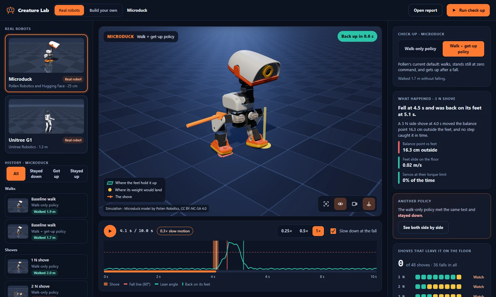

# Browser app

The browser app is the front door: pick a real robot, watch a saved shove in 3D, read why it
fell, and run a fresh check-up, all in one tab.

<p align="center">
  
</p>

<p align="center"><sub>Simulation. Microduck model by Pollen Robotics, CC BY-NC-SA 4.0.</sub></p>

## Start it

```bash
./run.sh                          # Linux; macOS: ./run.command; Windows: .\run.bat
uv run creature-lab app           # after `uv sync --inexact --extra web --extra robots`
```

A bare `creature-lab` opens the app too. The launcher installs the `viz`, `web` and `robots` extras
by itself the first time (prebuilt packages only; no compiler, no PyBullet). The app opens at
`http://localhost:8080` (the next free port if that one is busy). It reads and writes check-up
folders under `outputs/checkup`; pass `--checkups DIR` to use another one.

`python scripts/start.py --creature humanoid` (or `--mode build`) still opens the classic
build editor.

## What you can do

- **Choose a robot.** Microduck, the Unitree G1, H1 and H1-2 are the built-in choices. On a clean machine the
  app opens on the one whose first check-up is quickest (the G1, about 45 s), with a looping clip
  of its shove. **Download and check up** shows the license first; nothing is downloaded until you
  tick that you have read it. After the download the check-up starts by itself, and the results
  open when it ends.
- **Add your own robot.** *Add your own robot* under the cards takes the folder of a
  [robot pack](ROBOT_PACKS.md) (a MuJoCo model, a trained policy and a `robot.toml`), checks it,
  says each problem in plain words, and adds it. The robot gets a **Your robot** badge and the same
  check-up, 3D view and what-ifs; *Remove from the list* forgets it and leaves its files alone.
- **Ask "what if…".** Under a run, one click changes one thing (the shove from the other side, a
  harder or gentler shove, a very slippery floor, half speed or faster walking, a 6 kg load on the
  G1, a weak battery on the Microduck) and runs the robot again, about a second or two on a laptop.
  The new run opens next to the original with a sentence saying what the change did. It is saved
  with the check-up under **What if**, and asking again reuses it. The browser only picks a change
  from a fixed menu; it never sends numbers.
- **Watch a run.** The robot is drawn from its real meshes with a follow camera. The first run
  shown is a middle-strength shove that the robot got up from. Playback slows to 0.3x through
  the shove and the fall, as in the films; you can switch that off, pause, scrub, or change speed
  (arrow keys, Home and End work on the timeline).
- **See why.** The teal area on the floor is where the feet hold the robot up; it turns red when
  the yellow dot, where the body's weight would land, leaves it. The orange arrow is the shove. A
  legend sits on the view, and the panel on the right states the cause in words with the numbers
  behind it.
- **Try the fix.** When a run has a twin under the robot's other policy (same shove, same floor),
  a *Can it be fixed?* panel offers *See both side by side*: two views on one clock, both lean
  angles on one timeline, and a sentence saying which policy did better. Back goes back to one
  view.
- **Find a run.** The history can be filtered by how runs ended (stayed down, got up, stayed
  up). Each view has an address you can bookmark or reload; the back button works.
- **Run a check-up.** *Run check-up* starts the same run as `creature-lab robots checkup` in the
  background and shows its progress (about two minutes). If you reload the page meanwhile, it
  picks the running job up again. If you are watching a run when it finishes, you are told, not
  moved.
- **Open the report.** *Open report* shows the HTML report of the newest check-up, with its film.
- **Save a clip.** The camera button on the 3D view records the run from a moment before the
  shove to two seconds after the outcome, slow motion included, with the credit line on the
  video, and saves it as a WebM file.
- **Build your own.** Pick a quadruped, hexapod, worm or humanoid, reshape it with sliders, and
  see it in 3D as you move them. *Run simulation* runs it toward a goal (move forward, reach a
  target, stay balanced) with its packaged gait and shows what happened. *Open the classic
  editor* starts the part-by-part editor in a second tab (it needs the `sim` and `viz` extras).

Everything works from the keyboard: the first Tab stop is a skip link to the 3D view, the run
history is one stop (arrow keys move between runs), and the timeline takes the arrow keys, Home
and End. If your system asks for reduced motion, runs wait for you to press play.

## How it is built

| Part | Where | Notes |
| --- | --- | --- |
| Server | `creature_lab/web/` | FastAPI. `library.py` reads saved check-ups, `scene.py` turns a MuJoCo model and a run into binary arrays, `jobs.py` runs downloads and check-ups, `thumbs.py` renders cached thumbnails, `creatures.py` builds and runs the creatures designed in the browser, `builder.py` starts the classic editor. |
| Front end | `web-ui/` | React, three.js, Vite and TypeScript. |
| Built bundle | `creature_lab/web/static/` | **Committed**, so users never need Node. Rebuild it after changing `web-ui/` (see [web-ui/README.md](../web-ui/README.md)); CI fails when it is stale. |

The server sends meshes once per robot and poses per run as plain little-endian arrays (the layout
is documented in `scene.py`), not as JSON. The browser interpolates between frames, so a run
plays smoothly at any speed.

### Safety

The app is meant for your own machine.

- It listens on `127.0.0.1` and refuses requests whose `Host` is not `localhost`, `127.0.0.1` or
  `::1`, so a web page on another site cannot reach it through DNS rebinding.
- Anything that changes state (download, check-up, builder) must carry an `X-Creature-Lab`
  header. A web page on another origin cannot add one without a CORS preflight, and the server
  sends no CORS headers.
- The browser never supplies a file path. Runs are addressed by opaque ids the server derived,
  and static files cannot escape the bundle folder.
- Robot downloads need an explicit license acknowledgement in the request, in addition to the
  dialog.
- `--host` other than a loopback address prints a warning: the app can start CPU-heavy jobs and
  has no sign-in.

## Limits

- It shows simulations of the robots, not the hardware.
- On a computer without graphics acceleration the 3D view switches to a simplified drawing (no
  shadows, normal resolution) and says so.
- The area "where the feet hold it up" is the footprint of the feet touching the floor. For
  Microduck, whose feet are meshes, that is the part of each sole within 6 mm of the floor.
- The designer builds the four presets only. Adding or removing parts, joints and motors is
  the classic editor's job.
- Repeated check-ups of the same robot give the same results (the simulation is deterministic),
  so the app shows the newest one instead of a history of them.
